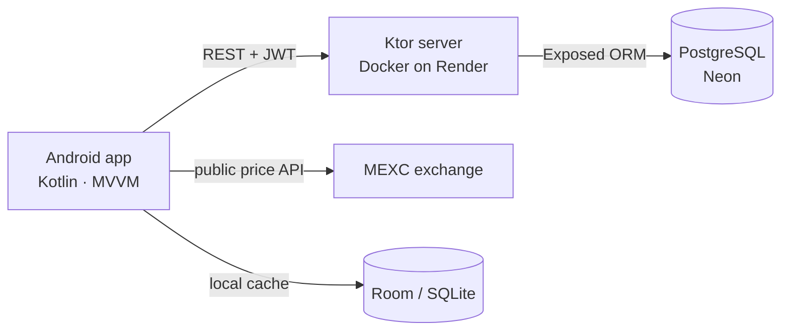

# BitCollector

**A crypto position tracker for Dollar-Cost Averaging (DCA), built as a native Android app with its own Kotlin backend.**

BitCollector helps you track crypto positions you build up over time. You open a position, add every buy and sell to it, and the app calculates your average buy price and live profit/loss using real-time prices from the MEXC exchange. Your data is synced to a cloud backend, so it's tied to your account rather than one phone.

The project has two parts:

| Part | Repository | Stack |
|---|---|---|
| Android app | this repo (`dcaandroid/`) | Kotlin, MVVM, Room, Retrofit |
| Backend API | [BitCollectorServer](https://github.com/mati-tech/BitCollectorServer) | Kotlin, Ktor, Exposed, PostgreSQL, JWT, Docker |

---

## Features

- **Account system**: register and log in; passwords are hashed with BCrypt, sessions use JWT tokens
- **Positions**: open a position for any coin with buy price and amount
- **DCA trades**: add BUY and SELL trades to a position; the app recalculates the **average buy price** after each trade
- **Live prices**: current prices are pulled from the MEXC public API
- **Profit & loss**: total PnL per position, colour-coded green/red
- **Close positions**: at the current market price or at a price you enter
- **History**: closed positions with filters for profitable and losing trades
- **Profile & settings**: edit profile, theme, language, delete account
- **Admin dashboard**: separate admin screens for managing users and data
- **Offline-ready local storage**: Room database with versioned schema migrations

---

## Architecture



**Android app**
- MVVM with `ViewModel` + `LiveData`, Kotlin Coroutines
- Retrofit + Gson for the backend and the MEXC API
- Room database (`trading_database`) with migrations between schema versions
- Jetpack Navigation (Safe Args), ViewBinding, Material Components, RecyclerView
- `minSdk 28`, `targetSdk 35`

**Backend** ([BitCollectorServer](https://github.com/mati-tech/BitCollectorServer))
- Ktor 3 (Netty) with content negotiation (kotlinx.serialization) and status pages
- JWT authentication (`ktor-server-auth-jwt`), BCrypt password hashing
- Exposed ORM on PostgreSQL, hosted on Neon
- Multi-stage Dockerfile (Gradle build → slim JDK 17 runtime), deployed on Render
- Serves a download page for the Android APK

---

## API overview

All `/positions` and `/positionDetails` routes require a JWT (`Authorization: Bearer <token>`).

| Method | Endpoint | Description |
|---|---|---|
| POST | `/register` | Create an account |
| POST | `/login` | Log in, returns a JWT |
| GET | `/positions/byUserId/{userId}` | All positions of a user |
| GET | `/positions/byId/{positionId}` | One position |
| POST | `/positions` | Create a position |
| PUT | `/positions/{positionId}` | Update a position |
| DELETE | `/positions/{positionId}` | Delete a position |
| GET | `/positionDetails/byPositionId/{positionId}` | All trades of a position |
| POST | `/positionDetails` | Add a BUY/SELL trade |
| PUT | `/positionDetails/{detailId}` | Update a trade |
| DELETE | `/positionDetails/{detailId}` | Delete a trade |

### Data model

```
users            (id, email, password_hash, full_name, role, registered_at)
positions        (id, user_id → users, coin, buy_price, amount, value_usd,
                  has_details, sell_price, position_pnl, buytimestamp, selltimestamp)
position_details (id, position_id → positions, trade_type BUY|SELL,
                  trade_amount, trade_price, total_cost, available_usd, timestamp)
```

---

## Getting started

### Android app

1. Clone the repo and open the `dcaandroid/` folder in Android Studio.
2. The backend URL is set in `remoteApi/client/ApiClient.kt` (`BASE_URL`). For a local server on the emulator, use `http://10.0.2.2:8080/`.
3. Run the `app` configuration on a device or emulator (Android 9+).

### Backend

```bash
git clone https://github.com/mati-tech/BitCollectorServer.git
cd BitCollectorServer
./gradlew run            # starts on http://localhost:8080
# or with Docker
docker build -t bitcollector-server .
docker run -p 8080:8080 bitcollector-server
```

---

## What I learned

- Designing a REST API and relational schema for financial data (positions → trades)
- Securing an API with JWT and hashed passwords
- Keeping an Android app's local Room database in sync with a remote backend, including schema migrations
- Containerising a Kotlin server and deploying it with a managed PostgreSQL database

---

## Author

**Matiullah Aziz**, Android & backend developer
[mati-tech.info](https://www.mati-tech.info/) · [LinkedIn](https://www.linkedin.com/in/mati-tech/) · azizmatiullah@yahoo.com
